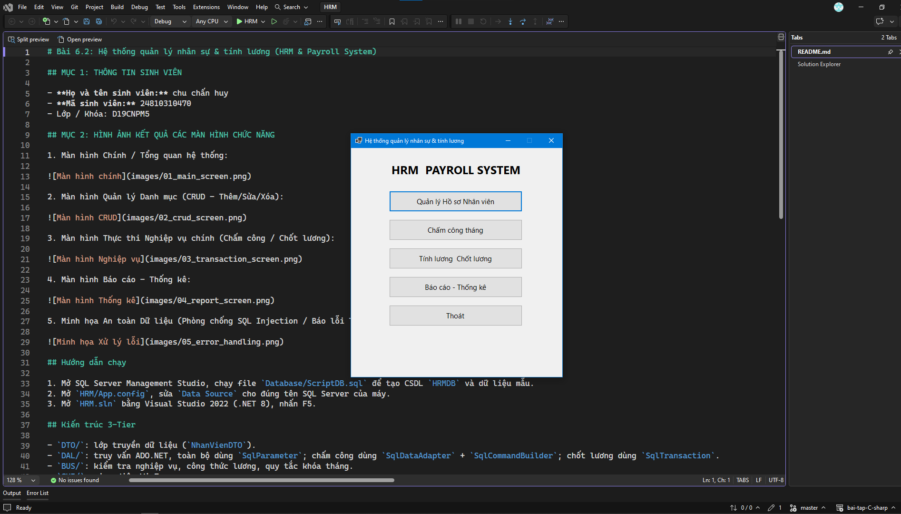
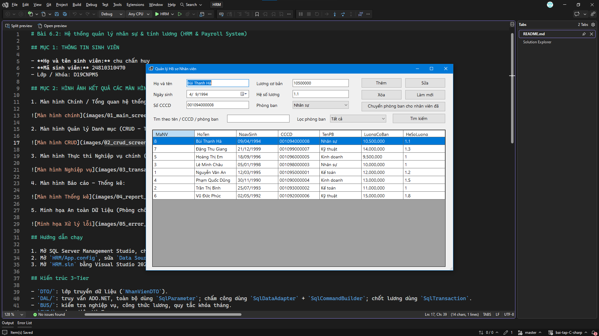
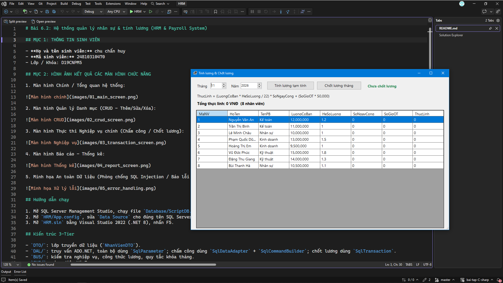
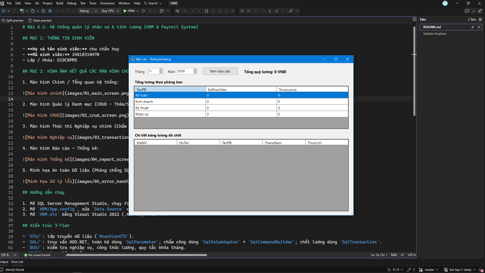
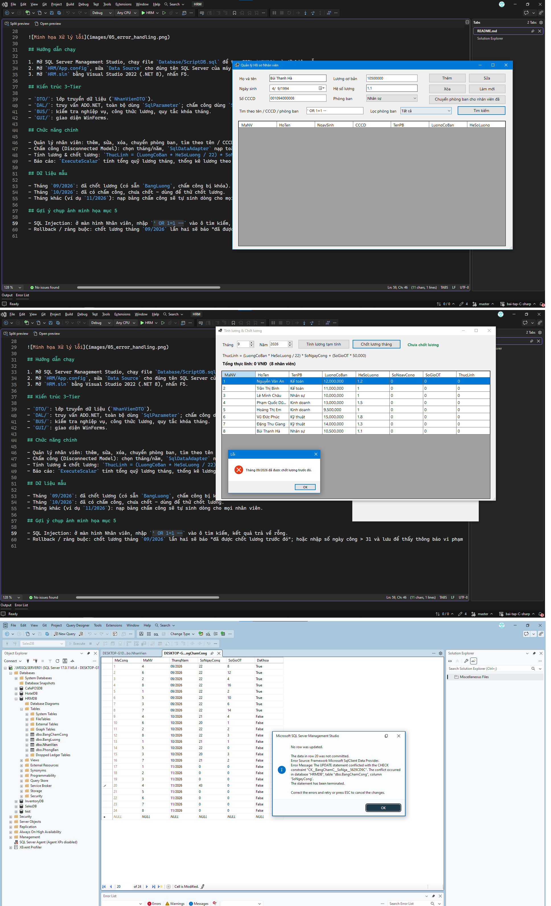

# Bài 6.2: Hệ thống quản lý nhân sự & tính lương (HRM & Payroll System)

## MỤC 1: THÔNG TIN SINH VIÊN

- **Họ và tên sinh viên:** chu chấn huy
- **Mã sinh viên:** 24810310470
- Lớp / Khóa: D19CNPM5

## MỤC 2: HÌNH ẢNH KẾT QUẢ CÁC MÀN HÌNH CHỨC NĂNG

1. Màn hình Chính / Tổng quan hệ thống:

2. Màn hình Quản lý Danh mục (CRUD - Thêm/Sửa/Xóa):

3. Màn hình Thực thi Nghiệp vụ chính (Chấm công / Chốt lương):

4. Màn hình Báo cáo - Thống kê:

5. Minh họa An toàn Dữ liệu (Phòng chống SQL Injection / Báo lỗi Transaction Rollback):

## Hướng dẫn chạy

1. Mở SQL Server Management Studio, chạy file `Database/ScriptDB.sql` để tạo CSDL `HRMDB` và dữ liệu mẫu.
2. Mở `HRM/App.config`, sửa `Data Source` cho đúng tên SQL Server của máy.
3. Mở `HRM.sln` bằng Visual Studio 2022 (.NET 8), nhấn F5.

## Kiến trúc 3-Tier

- `DTO/`: lớp truyền dữ liệu (`NhanVienDTO`).
- `DAL/`: truy vấn ADO.NET, toàn bộ dùng `SqlParameter`; chấm công dùng `SqlDataAdapter` + `SqlCommandBuilder`; chốt lương dùng `SqlTransaction`.
- `BUS/`: kiểm tra nghiệp vụ, công thức lương, quy tắc khóa tháng.
- `GUI/`: giao diện WinForms.

## Chức năng chính

- Quản lý nhân viên: thêm, sửa, xóa, chuyển phòng ban, tìm theo tên / CCCD / tên phòng ban và lọc theo phòng ban.
- Chấm công (Disconnected Model): chọn tháng/năm, `SqlDataAdapter` nạp toàn bộ nhân viên vào `DataTable`, nhập công và OT trên lưới, `SqlCommandBuilder` + `adapter.Update()` lưu một lần. Nhân viên chưa có dòng chấm công của tháng được tạo tự động khi nạp.
- Tính lương & chốt lương: `ThucLinh = (LuongCoBan * HeSoLuong / 22) * SoNgayCong + (SoGioOT * 50,000)`. Nút "Chốt lương tháng" mở một `SqlTransaction`: kiểm tra tháng chưa chốt, ghi `BangLuong` cho toàn bộ nhân viên có chấm công, đặt `DaKhoa = 1` cho `BangChamCong`, rồi `Commit`. Lỗi bất kỳ sẽ `Rollback`.
- Báo cáo: `ExecuteScalar` tính tổng quỹ lương tháng, thống kê lương theo phòng ban và chi tiết bảng lương.

## Dữ liệu mẫu

- Tháng `09/2026`: đã chốt lương (có sẵn `BangLuong`, chấm công bị khóa).
- Tháng `10/2026`: đã có chấm công, chưa chốt - dùng để thử chốt lương.
- Tháng khác (ví dụ `11/2026`): nạp bảng chấm công sẽ tự sinh dòng cho mọi nhân viên.

## Gợi ý chụp ảnh minh họa mục 5

- SQL Injection: ở màn hình Nhân viên, nhập `' OR 1=1 --` vào ô tìm kiếm, kết quả trả về rỗng.
- Rollback / ràng buộc: chốt lương tháng `09/2026` lần hai sẽ báo "đã được chốt lương trước đó"; hoặc nhập số ngày công > 31 và lưu để thấy thông báo vi phạm ràng buộc.
