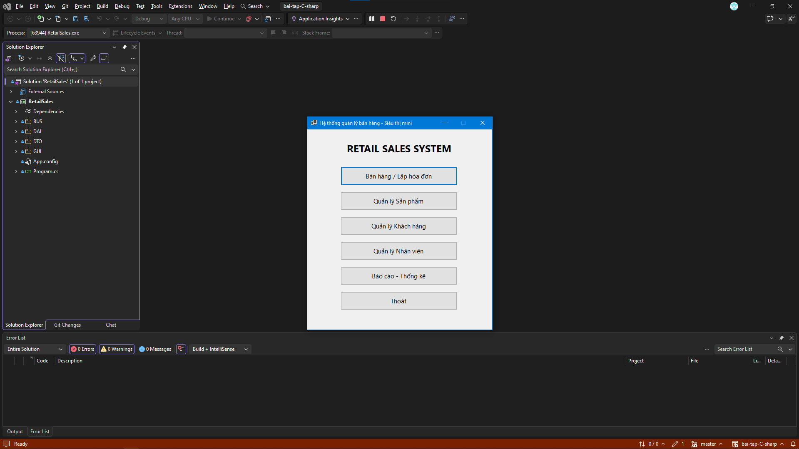
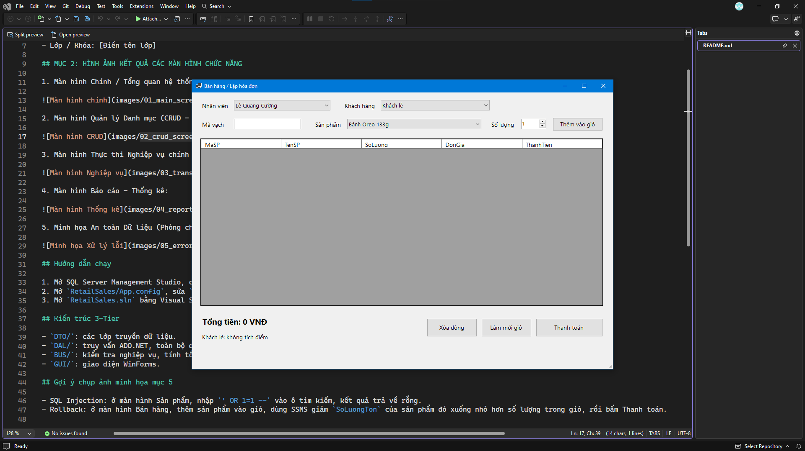
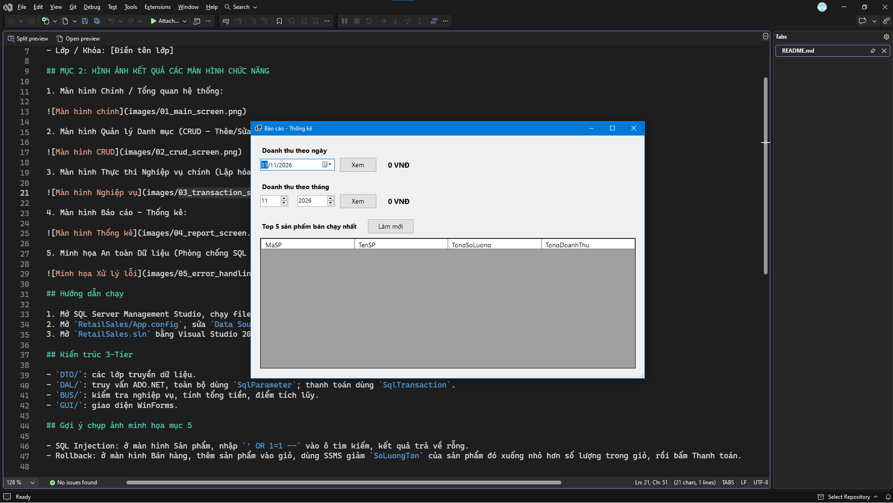

# Bài 6.1: Hệ thống quản lý bán hàng & siêu thị mini (Retail Sales System)

## MỤC 1: THÔNG TIN SINH VIÊN

- **Họ và tên sinh viên:** chu chấn huy
- **Mã sinh viên:** 24810310470
- Lớp / Khóa: D19CNPM5

## MỤC 2: HÌNH ẢNH KẾT QUẢ CÁC MÀN HÌNH CHỨC NĂNG

1. Màn hình Chính / Tổng quan hệ thống:

2. Màn hình Quản lý Danh mục (CRUD - Thêm/Sửa/Xóa):

3. Màn hình Thực thi Nghiệp vụ chính (Lập hóa đơn / Bán hàng):

4. Màn hình Báo cáo - Thống kê:

5. Minh họa An toàn Dữ liệu (Phòng chống SQL Injection / Báo lỗi Transaction Rollback):

## Hướng dẫn chạy

1. Mở SQL Server Management Studio, chạy file `Database/ScriptDB.sql` để tạo CSDL `SalesDB` và dữ liệu mẫu.
2. Mở `RetailSales/App.config`, sửa `Data Source` cho đúng tên SQL Server của máy.
3. Mở `RetailSales.sln` bằng Visual Studio 2022 (.NET 8), nhấn F5.

## Kiến trúc 3-Tier

- `DTO/`: các lớp truyền dữ liệu.
- `DAL/`: truy vấn ADO.NET, toàn bộ dùng `SqlParameter`; thanh toán dùng `SqlTransaction`.
- `BUS/`: kiểm tra nghiệp vụ, tính tổng tiền, điểm tích lũy.
- `GUI/`: giao diện WinForms.

## Gợi ý chụp ảnh minh họa mục 5

- SQL Injection: ở màn hình Sản phẩm, nhập `' OR 1=1 --` vào ô tìm kiếm, kết quả trả về rỗng.
- Rollback: ở màn hình Bán hàng, thêm sản phẩm vào giỏ, dùng SSMS giảm `SoLuongTon` của sản phẩm đó xuống nhỏ hơn số lượng trong giỏ, rồi bấm Thanh toán.
